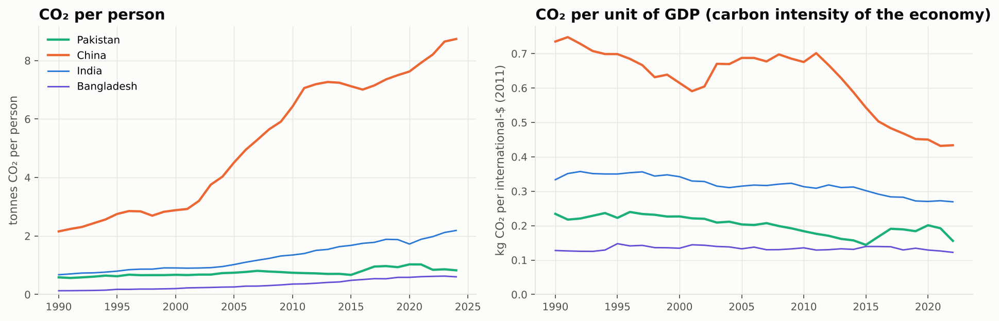
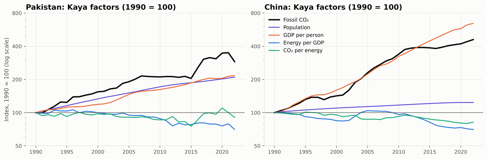
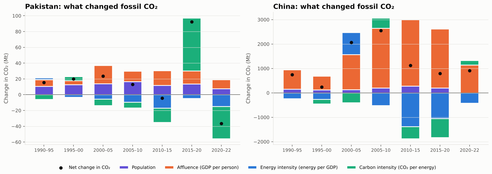
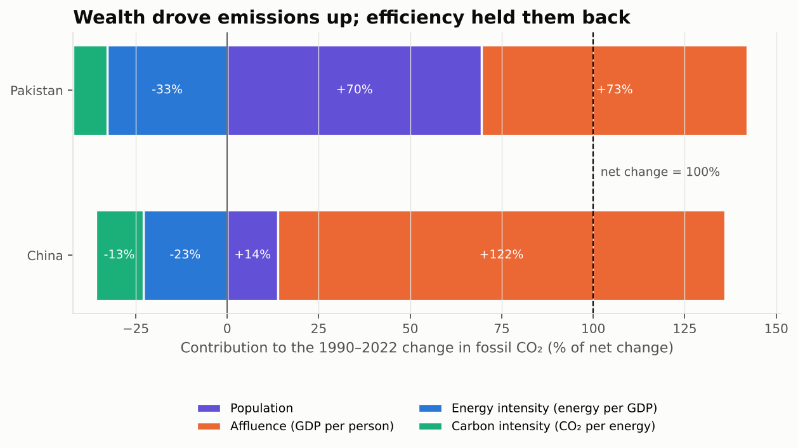
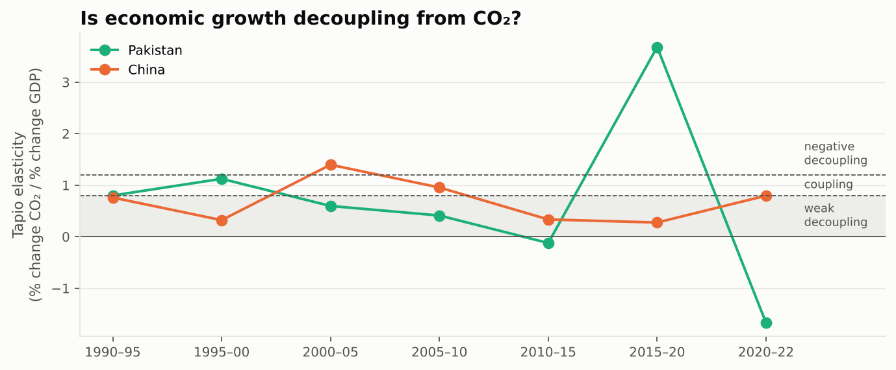
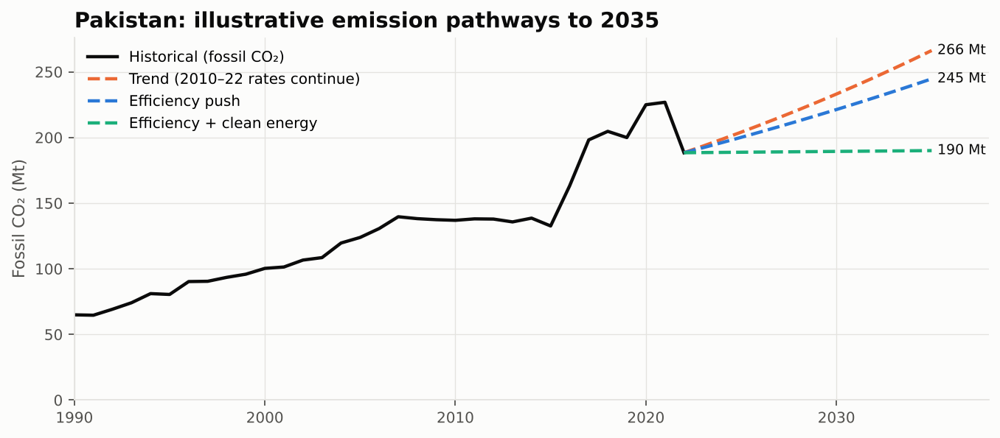

# What Drives CO₂ Emissions in Pakistan and China? Kaya–LMDI Decomposition and Decoupling Analysis, 1990–2022

**Author:** Hafza Noor · [Portfolio](https://hafzanoor.github.io/portfolio/) · [GitHub](https://github.com/hafzanoor)

Pakistan and China are neighbours at very different stages of development. In 2024 an
average person in China emitted **8.7 t CO₂**, while an average person in Pakistan emitted
**0.8 t**, below the world average of 4.7 t. Both countries have grown their emissions quickly
since 1990. This project asks **why**, using standard methods from energy and sustainability
research:

1. **Kaya identity**, which splits emissions into four drivers:
   CO₂ = Population × (GDP / Population) × (Energy / GDP) × (CO₂ / Energy)
2. **LMDI decomposition** (Logarithmic Mean Divisia Index, additive form), which measures
   how much of the change in emissions each driver caused, with no unexplained residual.
3. **Tapio decoupling analysis**, which tests whether economic growth is separating from
   emissions growth.
4. **Illustrative scenarios** for Pakistan's emissions to 2035.

## Key findings

| | Pakistan | China |
|---|---|---|
| Fossil CO₂, 1990 → 2022 | 64.9 → 188.4 Mt (**2.9×**) | 2,341 → 10,770 Mt (**4.6×**) |
| Population effect | **+70%** of net change | +14% |
| Affluence effect (GDP per person) | **+73%** | **+122%** |
| Energy-intensity effect | −33% | −23% |
| Carbon-intensity effect (fuel mix) | −9% | −13% |
| CO₂ per person, 2024 | 0.83 t | 8.74 t |

*Effects are shares of the net 1990–2022 change in fossil CO₂; they sum to 100%.*

- **Different engines of growth.** In China, rising incomes explain more than the entire
  increase in emissions. In Pakistan, population growth matters almost as much as rising
  incomes. Pakistan's population grew about 2.1× over the period, against 1.2× in China.
- **Efficiency is the main brake in both countries.** Energy used per unit of GDP fell
  by about 30% in both. This avoided roughly 40 Mt of CO₂ in Pakistan and 1,900 Mt in China.
- **Pakistan's fuel mix moved in the wrong direction after 2015.** Coal's share of
  fossil CO₂ rose from 9% in 2015 to 27% in 2020, as new coal-fired power plants came online.
  In 2015–2020, emissions grew 70% while GDP grew 19%, the worst decoupling result in the dataset.
- **China has been in "weak decoupling" since 2010.** Its emissions still grow, but much
  more slowly than its economy. The elasticity was 0.33 in 2010–15 and 0.28 in 2015–20.
- **Pakistan's 2020–22 "strong decoupling" should be read with care.** Emissions fell 16%,
  but this coincided with an economic and energy-import crisis, not a structural transition.

## 1. Emissions per person and per unit of GDP



China's emissions per person are now about 10 times Pakistan's. China's economy has
nevertheless become much less carbon-intensive since 2011. Pakistan's carbon intensity of GDP
fell slowly until 2015, then rose again.

## 2. The four Kaya drivers over time



In China, emissions track GDP per person closely, held down by falling energy intensity.
In Pakistan, population and income rise together, and the carbon intensity of energy
(green) jumps after 2015.

## 3. LMDI decomposition

The additive LMDI-I method attributes the change in emissions between years 0 and T to each
factor *x*:

ΔC_x = L(C_T, C_0) × ln(x_T / x_0), where L(a, b) = (a − b) / (ln a − ln b)

The four effects sum exactly to the total change. The code checks this, and the largest
residual is below 10⁻⁸ Mt.





## 4. Decoupling of economic growth and emissions

The Tapio elasticity is the % change in CO₂ divided by the % change in GDP.
With GDP growing: below 0 = strong decoupling, 0–0.8 = weak decoupling, 0.8–1.2 = expansive
coupling, above 1.2 = expansive negative decoupling.



| Period | Pakistan | | China | |
|---|---|---|---|---|
| 1990–95 | 0.80 | Weak decoupling | 0.76 | Weak decoupling |
| 1995–00 | 1.12 | Expansive coupling | 0.32 | Weak decoupling |
| 2000–05 | 0.60 | Weak decoupling | 1.40 | Expansive negative decoupling |
| 2005–10 | 0.41 | Weak decoupling | 0.95 | Expansive coupling |
| 2010–15 | −0.12 | Strong decoupling | 0.33 | Weak decoupling |
| 2015–20 | 3.68 | Expansive negative decoupling | 0.28 | Weak decoupling |
| 2020–22 | −1.67 | Strong decoupling | 0.80 | Weak decoupling |

## 5. Pakistan: illustrative pathways to 2035



Three simple scenarios project each Kaya factor forward from 2022:

| Scenario | Assumptions (per year) | Fossil CO₂ in 2035 |
|---|---|---|
| Trend | 2010–22 rates continue: population +1.7%, GDP per person +2.5%, energy intensity −1.9%, carbon intensity +0.4% | 266 Mt |
| Efficiency push | As trend, but energy intensity −2.5% | 245 Mt |
| Efficiency + clean energy | As above, and carbon intensity −1.5% | 190 Mt |

These are **illustrative what-if pathways, not forecasts**. They show that efficiency alone
slows growth in emissions, but holding emissions flat while the economy grows would also
need a cleaner energy mix.

## Limitations

- **Fossil CO₂ only.** The decomposition covers CO₂ from coal, oil and gas, not cement or
  land-use change, so that the Kaya identity holds exactly.
- **GDP data end in 2022** (Maddison Project 2023), so the decomposition stops there.
- **National totals hide structure.** A sector-level decomposition (power, industry,
  transport) would show where efficiency gains came from. That is a natural next step.
- **Scenarios are deliberately simple.** They are not energy-system models.

## How to run

```bash
pip install -r requirements.txt
python src/analysis.py        # about 10 seconds
```

The repository includes the data subset it needs. To refresh it, download
`owid-co2-data.csv` from [github.com/owid/co2-data](https://github.com/owid/co2-data) and
run `python src/make_subset.py path/to/owid-co2-data.csv`.

## Project structure

```
├── data/
│   ├── raw/          OWID CO2 data subset (Pakistan, China, India, Bangladesh, World) + codebook
│   └── processed/    Kaya factors by year
├── figures/          charts 01–06
├── results/          LMDI effects, decoupling table, scenarios, summary.json
└── src/
    ├── analysis.py   Kaya identity, LMDI, Tapio decoupling, scenarios, charts
    ├── make_subset.py
    └── style.py
```

## Data sources

- [Our World in Data – CO₂ and Greenhouse Gas Emissions dataset](https://github.com/owid/co2-data) (CC BY 4.0), which combines:
  - Global Carbon Budget (2026), for CO₂ emissions
  - Maddison Project Database (2023), for GDP in international-$ at 2011 prices
  - U.S. EIA International Energy Data (2026) and Energy Institute Statistical Review of World Energy (2025), for primary energy

## References

- Ang, B.W. (2005). The LMDI approach to decomposition analysis: a practical guide. *Energy Policy*, 33(7), 867–871.
- Kaya, Y. (1990). Impact of carbon dioxide emission control on GNP growth: interpretation of proposed scenarios. IPCC Energy and Industry Subgroup.
- Tapio, P. (2005). Towards a theory of decoupling: degrees of decoupling in the EU and the case of road traffic in Finland between 1970 and 2001. *Transport Policy*, 12(2), 137–151.

## License

Code: MIT. Data: CC BY 4.0, Our World in Data and original sources.
